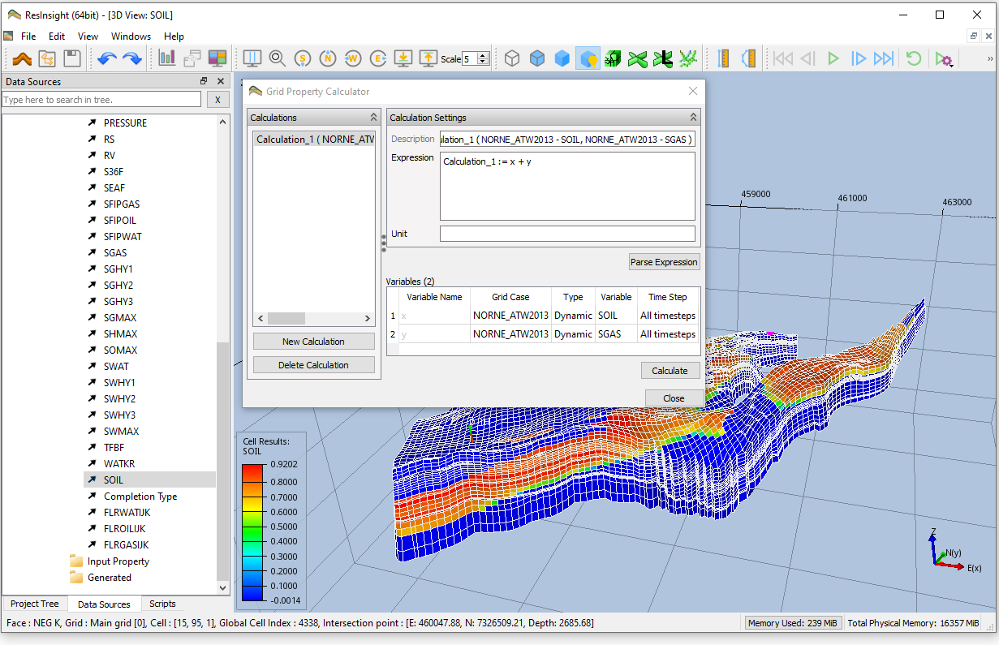
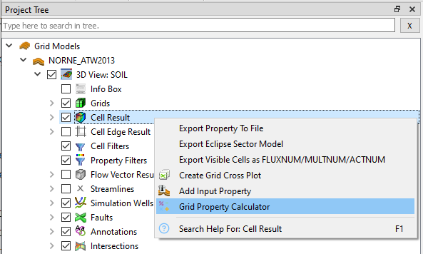
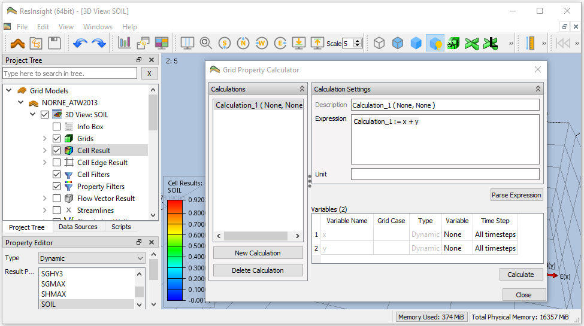
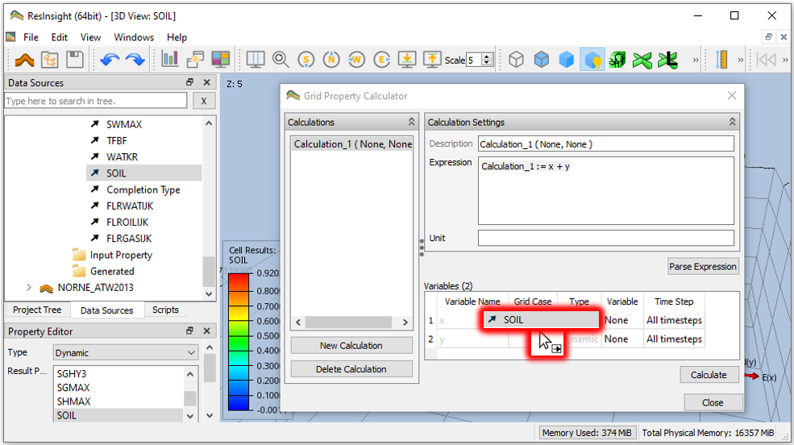
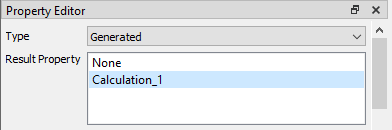
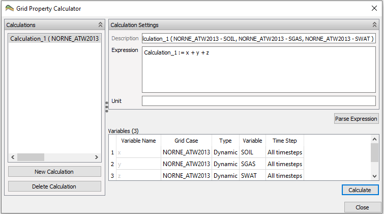

+++
title = "Grid Property Calculator"

weight = 20
aliases = [
    "/3d-main-window/gridpropertycalculator/",
    "/calculated-data/gridpropertycalculator/"
]
+++

ResInsight offers a built-in property calculator for grid parameters. 
The **Grid Property Calculator** enables arithmetic expressions to be parsed and calculated for visualization purposes. The expression can be applied to one or multiple grid models, and the expression text can be stored to a file for later use.

Expressions can be saved to a text file using the **Export Calculations** button. The default location for calculations can be set in **Preference->Import/Export**.

More details on mathematical operations are described in [Calculator Expressions]({})

## Invoking the Grid Property Calculator

Invoke the the **Grid Property Calculator** by pressing the calculator icon  in the menu bar or by right-clicking 
 **Cell Result** in **Project Tree**. 

## Example using Grid Property Calculator
As shown, the **Grid Property Calculator** is invoked by right-clicking 
 **Cell Result** in **Project Tree**.
As seen below, the **Grid Property Calculator** is per default prefilled with the simple summation 
*Calculation_1 := x + y*. 
This simple summation suffices for exemplifying its use.
However, you may change name of the calculation and add additional variables and arithmetic operators in the **Expression** field.

{}
**If** statements are also supported with the following syntax `NEW_TRANX := if((TRANX < 0.01), 0.01, TRANX)`
{}

The next step is to define the variables *x* and *y*. 
An easy way to define each variable is to drag and drop properties from **Data Sources**. See screenshot below for drag and drop of *SOIL* from **Data Sources** to the row of variable *x* in **Grid Property Calculator** (emphasized in red). 
Continue with drag and drop of *SGAS* to define *y*.

Finally, press **Calculate** to perform the actual calculation. 

The calculated result is accessible via **Property Editor** as **Type** ***Generated*** **Result Property**.

## Reference Procedure using Grid Property Calculator

1. Invoke the the **Grid Property Calculator** by right-clicking 
 **Cell Result** in **Project Tree**.
1. Define the expression for calculation by the involved variables and arithmetic operators
   - Type the name of calculation, required variables and arithmetic operators into **Expression**
   - Press button **Parse Expression** to verify the expression and referrals to actual variables
1. Define each actual variable referred by the expression, either manually or by drag and drop from **Data Sources**
1. Press **Calculate** to perform the actual calculation
1. Access the calculated result in **Property Editor** as **Type** ***Generated*** **Result Property**

## Cell Filter

Use the **Cell Filter** group to calculate the expression only for a subset of the grid cells. **Filter Type** has the following options:

- **None** -- all cells are calculated.
- **Cell Filter View** -- only cells visible in the selected view are calculated. The visible cells of the view are reused for all cases, so all cases must have the same grid size.
- **Data Filter** -- only cells accepted by the selected data filter are calculated.

When a filter is selected, **Non-visible Cell Value** controls the value assigned to cells outside the filter:

- **Infinity** -- cells are assigned an undefined value.
- **Property Value** -- cells are assigned the value of the selected property. Click **Edit** to select the property.
- **User Defined Custom Value** -- cells are assigned the value given in **Custom Value**.

### Data Filter

A data filter selects cells independent of the cells visible in any view. The **Data Filter** list contains the data filters defined on the destination case, and the data filters of the grid ensemble the destination case belongs to. Ensemble filters are listed as *Ensemble name : Filter name*.

The filter is evaluated for each calculated case and time step, using the active cells and result values of that case. A property filter or a formation filter can therefore select different cells in each case, and a filter on a dynamic property can select different cells for each time step.

Data filters are created by right-clicking a grid model or a grid ensemble in the **Project Tree** and selecting a filter from the **Data Filters** sub menu, see [Create Data Filters]({}#create-data-filters).

## Storage of Expressions to File
Use **Import Calculations** and **Export Calculations** to store and load expressions to and from a file.
