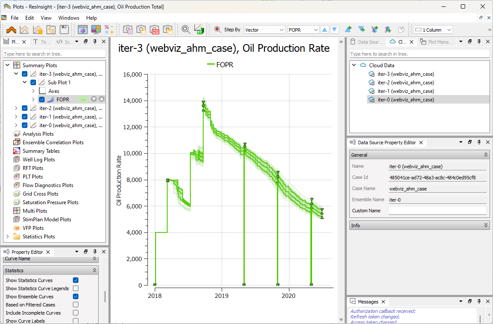
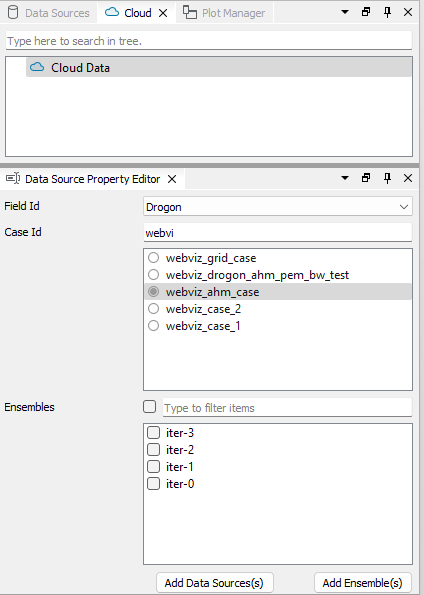
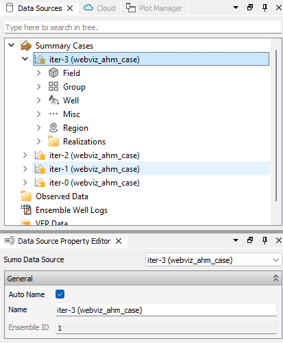
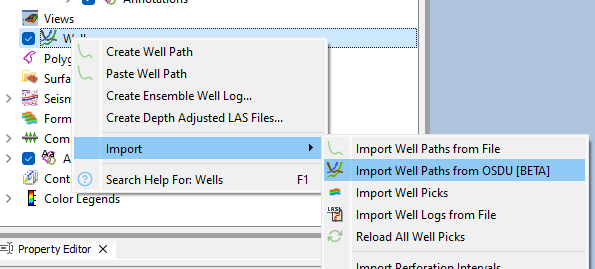
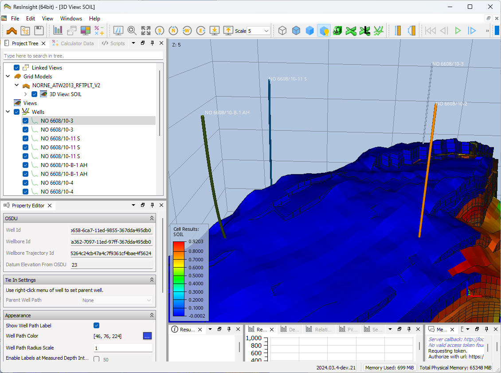

+++
title = "Cloud Services"

weight = 10
+++
 

Configuration of cloud services is described in [Cloud Services - Authorization]({}).

## Summary Ensembles from SUMO

Summary ensemble data can be accessed from SUMO. ResInsight will store the required information to the data source, and fetch data from the cloud during project import.

- Select **Cloud Data**, this will show available fields with cases in the **Data Source Property Editor**
- Select **Field** and **Case**, and a list of available ensembles are displayed
- Select **Ensembles** and push **Add Ensembles**. This operation creates a cloud ensemble data source and a summary plot connected to this data source.
- Use the button **Add Data Sources** if you want to avoid creation of summary plots

### Example of summary ensembles

### Example of summary plot with SUMO data

## Grid Ensembles from SUMO

Grid models stored as ROFF files in SUMO can be loaded as a grid ensemble, with one grid case per realization. The cloud data sources are also listed in **Data Sources** in the 3D main window.

1. Select the SUMO data source created as described in [Summary Ensembles from SUMO](#summary-ensembles-from-sumo).
1. In the **Property Editor**, use **Realization Filter** in **Ensemble Selection** to select the realizations, for example `0-10,!6`. Use `*` for all realizations.
1. Select the grid in **Grid Name** in **Grid Selection**.
1. Right-click the data source and select **Create Reservoir Grid Ensemble**.

The grid ensemble is added to the **Grid Models** folder, and a view is created for the first realization. See [Grid Case Ensembles]({}) for how to work with grid ensembles.

- **Compute Mobile Volume Weighted Mean** -- Show the mobile volume weighted mean in the 3D info box. This downloads the PORV and SWCR grid properties for every realization.

Grid properties are fetched from SUMO when they are displayed, one time step at a time. If all realizations have the same grid dimensions, the grid geometry is shared between the realizations.

A realization without grid data in SUMO is skipped. The skipped realizations are listed in the **Property Editor** of the grid ensemble and in the log.

### SUMO Grid Cases

Each realization in the grid ensemble is a **Sumo Grid Case**. The **Sumo** group in the **Property Editor** shows the SUMO case id, ensemble name, grid name and realization of the case.

## Polygons from SUMO

Polygons stored in SUMO can be displayed in 3D views. A SUMO data source must exist before polygons can be added.

1. Right-click **Polygons** in the **Project Tree** and select **Add Cloud Polygon Source**.
1. Select the **Data Source** and the **Base Realization** in the **Property Editor**.
1. Click **Apply** to fetch the list of available polygons. Click **Cancel** to discard changes to the selection.

The polygons are organized in the following folders:

- **Field Outline**
- **Structure Depth Fault Lines** -- One polygon per name.
- **Fluid Contact Outline** -- One folder per name, with one polygon per fluid contact type.

Right-click a polygon and select **Reload** to fetch it again from SUMO.

### Follow the View Realization

When the polygons are shown in a view of a SUMO grid case from the same data source, check **Auto-Follow View Realization** on the cloud polygon source in the **Polygons** folder of the view to display the polygons of the realization shown in the view. The option is on by default. For other views, the polygons of the **Base Realization** are displayed.

## Well Paths from OSDU®

From the right-click menu of **Wells**, select **Import Well Paths from OSDU**. A wizard will be displayed where field and well can be selected for import.

The imported well path will store required information to the location in OSDU, and the well path trajectory will be fethed during project import.

### Example of well paths from OSDU

